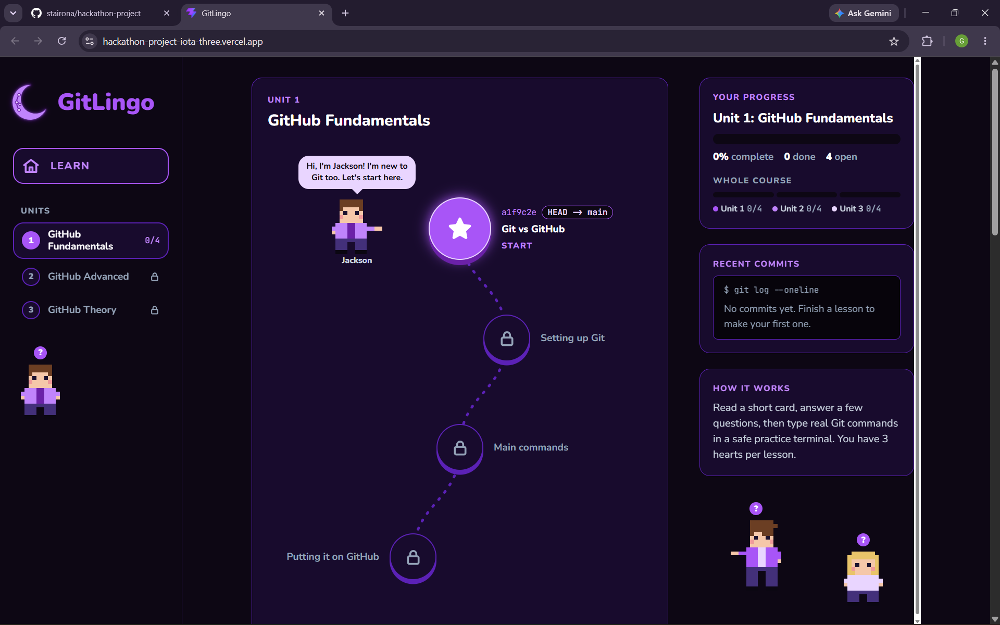
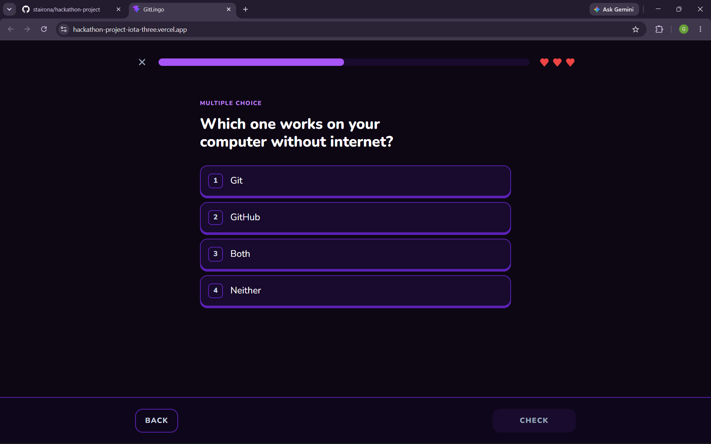

# GitLingo

A Duolingo-style web app that teaches Git and GitHub to beginners, in short lessons with a safe practice terminal.
Built in 24 hours by two beginners for a hackathon (Midnight Mode track, so it's dark by default).

**Live site:** https://hackathon-project-iota-three.vercel.app/





## What you can do

- **Follow a path of 12 lessons in 3 units:** GitHub Fundamentals, GitHub Advanced and GitHub Theory. The path is drawn like `git log`: each finished lesson gets a short commit hash, and your current lesson is marked `HEAD -> main`.
- **Learn from short teaching cards,** then answer **multiple-choice questions** and type real commands into a **practice terminal**. Nothing you type runs. GitLingo checks it against the accepted answers and shows realistic output.
- **Play as a character.** Jackson, Charley and Lily each guide a unit and star in the lessons, with a profile card that has the info you need (like a repo URL you can copy).
- **Get instant feedback.** A green or red bar after every CHECK explains why. You get 3 hearts per lesson, a wrong answer costs one, and you can go BACK to review earlier screens.
- **Keep your progress.** Finished lessons are saved in your browser, so you can close the tab and come back.

## Run it locally

You need [Node.js](https://nodejs.org) (the LTS version).

```
npm install      # download the packages (once)
npm run dev      # start the app at http://localhost:5173
npm run build    # build the site the same way Vercel does
npm run lint     # check the code for common mistakes
```

## How it's built

We kept the stack small on purpose, so we could understand all of it.

- **Vite + React:** function components and hooks only. React and React DOM are our only dependencies.
- **Plain CSS with CSS variables:** every color, size and spacing value lives in `src/styles/global.css`. No Tailwind, no UI libraries.
- **Lessons are JSON files:** one file per lesson, in `src/content/units/unit-N/lessons/`. `src/content/index.js` finds them automatically with Vite's `import.meta.glob`.
- **Progress lives in `localStorage`:** no backend, no accounts. Every read and write is wrapped in try/catch, so a blocked browser doesn't crash the app.
- **GitHub + Vercel:** every merge into `main` deploys automatically.

```
src/
  pages/        Home (the map) and Lesson (one lesson, screen by screen)
  components/   layout/, map/, characters/ and lesson/
  content/      the units and lessons (JSON), and the characters
  utils/        small plain functions, like the answer checker
  hooks/        useProgress (saved progress)
docs/
  lessons/              every lesson written out in plain words first
  understanding-log.md  every PR, how AI helped, and how to explain it
```

## Decisions we made (and why)

- **Answers are case-sensitive, but extra spaces don't matter.** Real Git treats `Add-Dark-Mode` and `add-dark-mode` as different branches, so we don't hide that. A phone keyboard's autocorrect is turned off in the terminal for the same reason.
- **One file per lesson.** Our big unit files kept causing merge conflicts when we both edited them. Now two people editing two lessons never touch the same file.
- **Merging is taught on GitHub with a pull request,** not with `git merge` in the terminal, because that's how most teams actually do it.
- **No retries.** A wrong answer shows the right one and moves on, like Duolingo. You can go BACK to look, but checked answers stay locked, so hearts can't be won back.
- **State lives in one place.** The lesson screen decides if an answer is right. The question components only draw things and report clicks.

## How we used AI

We used **Claude Code** (an AI coding assistant) throughout, under one hackathon rule: **we must understand every tool and every line of code we use.**

- **As a tutor and reviewer:** Claude explained concepts, errors and trade-offs, reviewed our code and fact-checked Git commands in our lessons.
- **As a coder, when we asked:** Claude wrote some components and helpers at our request. We then tested them, made the commits ourselves and reviewed each other's PRs before merging.
- **Lesson content:** we planned every lesson and its story. Claude helped draft the text from our decisions, and we reviewed it and checked every Git fact.
- **We didn't just accept suggestions.** We changed plans when they didn't fit, for example one file per lesson instead of a folder per lesson, skipping a lesson template we wouldn't use in time, and a simpler back button that reused existing code.

Every PR has an entry in [docs/understanding-log.md](docs/understanding-log.md) that says what AI did and how to explain the code in our own words.

## Team

- **Gavin Rush:** lesson content (all three units), the lesson JSON and helpers (answer checker, lesson steps, code text), multiple-choice questions, the practice terminal, hearts and the back button.
- **Nicolas Aguirre:** app setup, the theme and map, the guide characters, the lesson screen frame, end screens and demo users.

## Future improvements

We left these out on purpose to finish in 24 hours. Here's what we'd add next:

- **More units:** cover topics beginners hit next, like fixing merge conflicts, `git stash`, `git rebase`, and GitHub Actions.
- **More question types:** for example, put commands in the right order (add, commit, push) or fill in the missing part of a command.
- **Accounts and cloud saving:** progress is only saved in your browser right now. Accounts would need a backend, but would let you continue on any device.
- **Streaks and XP:** small daily rewards that bring people back, like Duolingo. We skipped them to focus on the lessons themselves.
- **A light theme:** every color is already a CSS variable, so a light theme just means a second set of values.
- **Sound effects:** a short sound for right and wrong answers, with a mute button.
